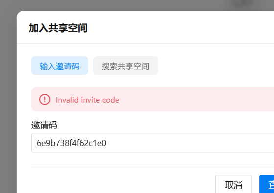

# 分享邀请链接邀请成员加入共享空间，邀请码提示“Invalid invite code”

**缺陷类型**：Primind 共享空间邀请码校验与提示。**状态**：修复已完成，在独立 worktree `dsh-7751f7a1-80f6`（基线 `main@633ba77`）按 spec §6 复测通过，**未合并**（2026-11-27）。修复 spec 与复测记录见 [BF-06](../in-progress/bug-fixes/BF-06-共享空间邀请码失效提示与链接入口.md)。本次失败的直接原因仍未核实：没有目标环境的访问权限，详见下文“本次直接原因”。本文日期和时间为北京时间（UTC+08:00）；下文的代码行号按分析时的 `main@746189f`，修复后的代码以 worktree 为准。

## 现象

在共享空间的「设置 → 邀请成员」中复制邀请链接（`/join?code=…`）发给成员。打开链接后弹出「加入共享空间」窗口，没有显示空间信息，而是提示：

```text
Invalid invite code
```

切到「输入邀请码」页签，填入链接里的邀请码 `6e9b738f4f62c1e0` 再点「查看」，结果相同。界面是中文，这条提示却是英文。



## 请求与返回

两个入口最终都调用同一个预览接口。按代码推断的返回如下，未抓包：

```text
GET /api/v1/organizations/preview/6e9b738f4f62c1e0
status_code=404
response_body={"success":false,"error":{"code":1003,"message":"Invalid invite code","details":null}}
```

修复后同一个接口对“已过期”和“不存在”分别返回 `code=2401` 和 `code=2400`，状态码和英文原文不变（旧前端看到的与上面完全一样）。

## 原因

### 已确认（代码，修复前）

1. **后端把“已过期”和“不存在”合并成同一句提示。** 仓储层按 `invite_code` 查空间，查不到返回 `ErrInviteCodeNotFound`；查到但 `invite_code_expires_at` 早于当前时间返回 `ErrInviteCodeExpired`。服务层把两者分别转成 `ErrOrgNotFound` 和 `ErrInviteCodeExpired`，handler 不区分，一律返回 404 `Invalid invite code`。预览、直接加入、提交申请三个接口都是这样写。[仓储查询](../../internal/application/repository/organization.go#L56) · [过期判断](../../internal/application/repository/organization.go#L64) · [服务层转换](../../internal/application/service/organization.go#L161) · [预览](../../internal/handler/organization.go#L617) · [加入](../../internal/handler/organization.go#L675) · [申请](../../internal/handler/organization.go#L727)
2. **前端优先显示后端原文。** 预览失败时，请求封装从返回体取出 `error.message` 作为 `message`，`previewOrganization` 再把它原样放进 `result.message`；页面优先显示 `result.message`，只有它为空才用中文文案「邀请码无效或已过期」。这条中文文案在该路径上走不到。[取出后端 message](../../frontend/src/utils/request.ts#L217) · [接口封装](../../frontend/src/api/organization/index.ts#L430) · [页面提示](../../frontend/src/views/organization/OrganizationList.vue#L831) · [中文文案](../../frontend/src/i18n/locales/zh-CN.ts#L2332)
3. **邀请码会过期，且不会自动续期。** 空间创建时生成 16 位十六进制邀请码，默认有效期 7 天，到期后一直失效，直到管理员点「刷新邀请码」。刷新会用新码覆盖旧码，之前发出去的链接立刻失效。修改有效期只影响之后刷新生成的邀请码，不改变当前邀请码的到期时间。[默认 7 天](../../internal/application/service/organization.go#L19) · [创建时生成](../../internal/application/service/organization.go#L108) · [刷新生成](../../internal/application/service/organization.go#L486) · [覆盖旧码](../../internal/application/repository/organization.go#L259) · [有效期说明文案](../../frontend/src/i18n/locales/zh-CN.ts#L2240)
4. **预览失败时后端不写应用日志。** handler 直接 `c.Error`，没有记录邀请码和失败原因，事后只能从访问日志看到 404，无法区分是过期还是不存在。
5. **链接入口失败时，输入框是空的。** 通过 `/join?code=…` 进入时，页面只把邀请码存进 `inviteCode`，没有回填到输入框 `joinInputCode`；预览失败后窗口停在「输入邀请码」页签，需要重新手工粘贴。截图中的输入框带有邀请码，只通过链接打开时不会自动带上它。[链接入口](../../frontend/src/views/organization/OrganizationList.vue#L1072) · [只设置 inviteCode](../../frontend/src/views/organization/OrganizationList.vue#L831)
6. **前端接口封装丢掉了错误码。** 请求拦截器把返回体展开到抛出的对象上，错误码在 `e.error.code`（模型删除的 `ModelInUseError` 就是这样取的）。但 `previewOrganization`、`joinOrganization`、`submitJoinRequest` 三个封装在 `catch` 里只返回 `{ success: false, message }`，`error.code` 被丢弃，页面即使想按错误码区分也拿不到。[请求拦截器](../../frontend/src/utils/request.ts#L225) · [封装](../../frontend/src/api/organization/index.ts#L405) · [取码先例](../../frontend/src/api/model/modelUsage.ts#L102)
7. **数据库等内部错误也被报成“邀请码无效”。** 预览和申请接口对服务层返回的任何错误都返回 404 `Invalid invite code`，加入接口除“成员已满”外同样如此。数据库超时或连接失败时，用户看到的也是“邀请码无效”，会误导排查。加入接口在空间需要审核时返回 `ErrOrgPermissionDenied`，同样被报成邀请码无效（前端会对需审核空间改走申请接口，只有直接调接口或 CLI 会碰到）。[服务层加入](../../internal/application/service/organization.go#L544)
8. **邀请链接的域名取自管理员当时的浏览器地址。** 链接按 `window.location.origin` 拼接。管理员在测试环境、本机或另一套部署里复制的链接，指向的是那套环境的数据库；成员在正式环境输入同一个码也查不到。[拼接链接](../../frontend/src/views/organization/OrganizationSettingsModal.vue#L1219)
9. **输入页签的说明与实际不符。** 说明文字是“输入邀请码或粘贴邀请链接中的邀请码”，但输入框不解析链接。直接粘贴整条链接时，请求路径里带有 `/` 和 `?`，到不了预览接口，提示同样是失败。[输入预览](../../frontend/src/views/organization/OrganizationList.vue#L926)

### 本次直接原因（未核实）

`6e9b738f4f62c1e0` 是 16 位十六进制，与生成规则一致；输入框上限 32 位，不存在截断。可以排除格式问题。后端查不到这个码对应的有效空间，可能性按大小排列：

| 可能原因 | 说明 | 核对方法 |
| --- | --- | --- |
| 邀请码已过期 | 空间创建或上次刷新已超过有效期（默认 7 天），链接里的码到期 | 打开该空间「设置 → 邀请成员」，看邀请码下方是否显示「已过期」；或查库 `SELECT id, name, invite_code, invite_code_expires_at, deleted_at FROM organizations WHERE invite_code = '6e9b738f4f62c1e0';` |
| 邀请码被刷新过 | 复制链接之后有人点了「刷新邀请码」，旧码被覆盖 | 同上，看库中 `invite_code` 是否已不是这个值 |
| 空间已删除 | 软删除的行会被查询自动排除 | 同上，看 `deleted_at` |
| 链接来自另一套环境 | 管理员在测试环境、本机或另一套部署中复制链接，成员打开的环境里没有这个码 | 对比链接域名和成员浏览器地址栏；在成员所用环境的库里执行上面的查询 |
| 数据库查询出错 | 内部错误也被报成 404 `Invalid invite code`（见原因 7） | 查同一时间段的应用错误日志；可能性低 |
| 复制或输入有误 | 手工输入时出错 | 对照设置页显示的邀请码；截图里的码格式正确，可能性低 |

**核对情况（2026-11-27）：仍未核实。** 开发和复测都没有线上数据库和日志的访问权限。本机 WSL 的开发库 `primind-dev-postgres` 里 `organizations` 表是空的，不存在这个码对应的空间，所以本机也无法确认当时是哪一种原因。

修复上线后不需要再靠人工排查：每次失败在后端应用日志里有一行，`reason=expired` 是过期，`reason=not_found` 是被刷新或根本没有这个码（也可能是另一套环境的码，需对比链接域名），邀请码显示前 4 位，可以和成员报的码对上。另外管理员在设置页看“已过期”标记不需要数据库权限，这一步就能排除最常见的原因。请有目标环境权限的同事按上表核对一次，把结论补在这里。

## 影响范围

- 所有通过邀请链接或邀请码加入共享空间的用户。使用默认 7 天有效期、创建后从未刷新过邀请码的空间，7 天后发出去的链接全部失效。
- 成员看到的提示是英文，不说明是「已过期」还是「不存在」，不知道该向管理员索取新链接；管理员端没有任何提示或日志。
- 「直接加入」和「提交申请」有同样的问题：后端对过期邀请码同样返回 `Invalid invite code`。

## 临时处理

空间管理员打开「设置 → 邀请成员」：

1. 邀请码下方显示「已过期」时，点刷新按钮，重新复制邀请链接发给成员。
2. 希望链接有效期更长时，先把「邀请链接有效期」改为 30 天或永不过期，再点一次刷新。只改有效期不刷新，当前邀请码仍按原来的时间到期。
3. 成员收到新链接后重新打开，或在「输入邀请码」里填入新的邀请码。

修复上线后，第 1 步变成：点「复制链接」时页面会提示「当前邀请码已过期，复制出去也无法使用。」，直接点「刷新并复制」即可。

## 修改建议

完整设计、任务拆分和验收见 [BF-06](../in-progress/bug-fixes/BF-06-共享空间邀请码失效提示与链接入口.md)，这里只列要点。以下 5 条都已实现。

1. 后端：三个接口共用一个错误映射函数。过期和不存在分别返回新的业务错误码（2400“邀请码不存在”、2401“邀请码已过期”），HTTP 状态码和英文原文保持 404 `Invalid invite code` 不变，旧前端不受影响；数据库等内部错误改为 500，不再报成邀请码无效。失败时记录一条应用日志，带脱敏后的邀请码和原因。[预览](../../internal/handler/organization.go#L617)
2. 前端：三个接口封装在失败时保留 `e.error.code`；页面按错误码显示中文文案，「邀请码已过期，请向空间管理员索取新的邀请链接」和「邀请码无效」分开，已知错误不显示后端原文。[页面提示](../../frontend/src/views/organization/OrganizationList.vue#L831) · [加入失败提示](../../frontend/src/views/organization/OrganizationList.vue#L862)
3. 链接入口：`/join?code=…` 预览失败时把邀请码回填到输入框；输入框粘贴整条链接时自动取出 `code`。[链接入口](../../frontend/src/views/organization/OrganizationList.vue#L1072)
4. 管理员端：邀请码已过期时，复制链接前提示先刷新，并提供「刷新并复制」。[剩余有效期](../../frontend/src/views/organization/OrganizationSettingsModal.vue#L1239) · [复制链接](../../frontend/src/views/organization/OrganizationSettingsModal.vue#L1641)
5. 未登录打开邀请链接：登录后回到原链接（见下文“附带观察”），一并在 BF-06 中处理。

## 回归验收

- 邀请码已过期时，预览、直接加入、提交申请三处都提示含「已过期」的中文文案；不存在的邀请码提示「邀请码无效」。中文界面不出现英文原文。
- 邀请码刷新后，旧链接提示失效，新链接可以正常预览并加入。
- 通过 `/join?code=…` 进入且预览失败时，输入框里带有该邀请码。
- 邀请码过期后，管理员复制链接时能看到需要刷新的提示。
- 后端应用日志能查到失败的邀请码（脱敏）和原因。
- 数据库不可用时，预览返回“预览失败，请稍后重试”，不再提示邀请码无效。
- 在输入框粘贴整条邀请链接，能正常预览。
- 未登录打开邀请链接，登录后自动回到加入窗口。

以上各条的复测结果（含截图对应的操作和接口返回）见 [BF-06 §12.3](../in-progress/bug-fixes/BF-06-共享空间邀请码失效提示与链接入口.md#123-63-端到端本机-wsl-docker)。

## 附带观察（代码已确认）

未登录的用户打开 `/join?code=…` 时，`/join` 先重定向到 `/platform/organizations?invite_code=…`，路由守卫再直接跳到 `/login`，没有带上返回地址；登录页也不读取任何返回地址参数。登录后邀请码丢失，需要重新打开链接。这是另一个问题，不是本次提示的原因，但影响同一条邀请流程，已在 BF-06 中一并修复：守卫带上 `redirect`，登录后回到原处，返回地址只接受站内路径。[/join 重定向](../../frontend/src/router/index.ts#L77) · [守卫跳转](../../frontend/src/router/index.ts#L373)

复测时还发现两处既有问题，不在本次范围内，已记入 [BF-06 §10.6](../in-progress/bug-fixes/BF-06-共享空间邀请码失效提示与链接入口.md#106-复测中发现的既有问题不在本期范围建议另开单)：访问日志仍会打印完整的邀请码；数据库整体不可用时认证中间件先返回 401，请求到不了这三个接口。

## 开发与验收 spec

[BF-06 共享空间邀请码失效提示与链接入口](../in-progress/bug-fixes/BF-06-共享空间邀请码失效提示与链接入口.md)，优先级 P1。开发完成，在 worktree `dsh-7751f7a1-80f6` 复测通过，未合并。
